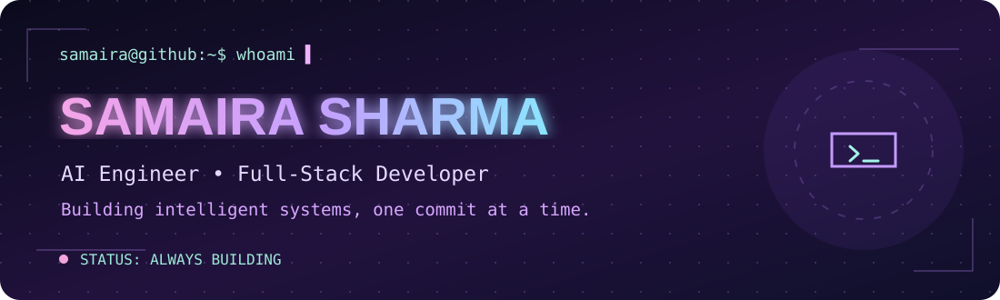

<div align="center">



<br/><br/>


<br/><br/>


</div>

---

## `> whoami` 👩🏻‍💻

```yaml
name: Samaira Sharma
education: B.Tech Information Technology
college: K. J. Somaiya School of Engineering
location: Mumbai, India

currently_building:
  - AI-powered applications
  - Multi-agent intelligent systems
  - Full-stack platforms
  - Financial technology solutions

interests:
  - Artificial Intelligence
  - Financial Technology
  - Software Engineering
  - Research
  - Competitive Programming

motto: "Build. Break. Learn. Repeat."
```

I'm an Information Technology undergraduate passionate about building intelligent applications that solve real-world problems.

From AI-powered financial research and multi-agent systems to full-stack applications, I love combining engineering, creativity, and problem-solving.

---

## `> achievements --unlocked` 🏆

<div align="center">


<br/><br/>


<br/><br/>


<br/><br/>


</div>

### 🥈 JPMorgan Chase Code for Good 2026

**Runner-Up | Mumbai**

Built a beneficiary operations platform for ISRA, supporting onboarding, eligibility checks, OCR-assisted document validation, and approval workflows.

### 📈 Finding the Next Signal — BITS Pilani Hyderabad

**Finalist | Financial Research Hackathon**

Developed SignalForge, an AI-powered investment research workflow focused on financial claim verification, evidence triangulation, and contradiction detection.

### 🏅 DataZen Case Study Competition

**Finalist**

### 📜 NISM Series V-A

**Certified Mutual Fund Distributor**

---

## `> tech-stack --list` 💻

<div align="center">

### ✦ Programming Languages


<br/><br/>


### ✦ Frontend Development


### ✦ Backend Development


### ✦ Databases


### ✦ AI / ML / Data


### ✦ Developer Tools


</div>

---

## `> currently-exploring` 🚀

- 🤖 Agentic AI and multi-agent workflows
- 📈 AI applications in finance and investment research
- 🧠 Retrieval-Augmented Generation (RAG)
- 💻 Full-stack engineering
- 🔬 Research and intelligent automation

---

## `> github --streak` 🔥

<div align="center">


<br/><br/>


</div>

---

## `> contribution-activity` 📊

<div align="center">


</div>

---

## `> ./contribution-snake` 🐍

<div align="center">


</div>

---

## `> connect --with-me` 💌

<div align="center">

<a href="mailto:samairasharma152@gmail.com">
  
</a>

<a href="https://github.com/samairaxox">
  
</a>

<br/><br/>

<sub>✦ Thanks for stopping by. Stay curious, keep building. ✦</sub>

</div>
